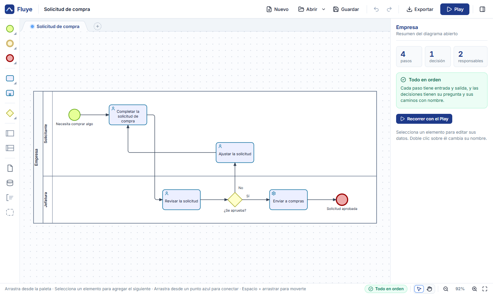
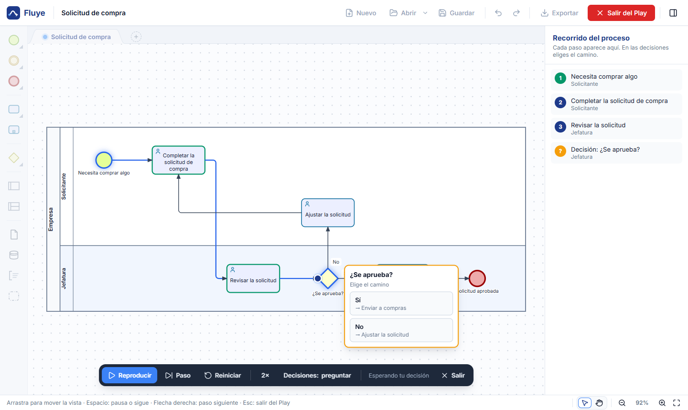

<p align="center">
  
</p>

<h1 align="center">Fluye</h1>

<p align="center">
  Programa gratis y de código abierto para hacer <strong>diagramas BPMN y diagramas de flujo</strong> en Windows, en español, con un <strong>Play</strong> que recorre el proceso paso a paso.<br>
  <em>A free, open-source BPMN modeler and flowchart maker for Windows, with a Play button that walks through your process step by step.</em>
</p>

<p align="center">
  <a href="https://github.com/ematurana-code/fluye/releases/latest"><strong>Descargar para Windows</strong></a> ·
  <a href="https://ematurana-code.github.io/fluye/">Página del proyecto</a> ·
  <a href="https://ematurana-code.github.io/fluye/demo/">Probar en el navegador</a> ·
  <a href="https://ematurana-code.github.io/fluye/plantillas/">Plantillas</a> ·
  <a href="https://ematurana-code.github.io/fluye/guias/que-es-bpmn/">Qué es BPMN</a> ·
  <a href="#english">English</a>
</p>



## Qué hace

- **Dibuja procesos con BPMN 2.0**, el estándar de la OMG: pools, carriles, tareas, decisiones, paralelos, eventos, mensajes entre pools, subprocesos, documentos y notas.
- **Play paso a paso:** recorre el proceso como si fuera de verdad. En cada decisión preguntas qué camino sigue (o lo dejas al azar), y avisa si algo se atasca: un paso sin salida, un paralelo que nunca se junta o un mensaje que nunca llega.
- **Revisión mientras dibujas:** el panel avisa qué falta (inicio, fin, pasos sueltos, decisiones sin pregunta) y te lleva al elemento con un clic.
- **33 plantillas** de 11 áreas (compras, finanzas, recursos humanos, soporte TI, ventas, logística, aduana y más), en tres niveles: simple, intermedia y avanzada.
- **Varios diagramas por archivo**, cada uno en su pestaña. Un subproceso se abre en su propia pestaña para dibujar lo que pasa adentro.
- **Exporta** a BPMN, PNG, SVG, PDF, Word (documentación con la ficha de cada paso) y a una **página web interactiva**: un solo archivo .html que cualquiera abre en el navegador, con el Play incluido.
- **Compatible:** abre y guarda .bpmn estándar, también los que exportan otras herramientas de modelado (incluidos sus colores).
- **Corrector ortográfico** en español, sin internet.



## Instalar

1. Descarga `Fluye-Instalar-<versión>.exe` desde [Releases](https://github.com/ematurana-code/fluye/releases/latest).
2. Ábrelo con doble clic. Se instala para tu usuario, sin pedir administrador, y queda en el escritorio y en el menú Inicio.
3. Si Windows muestra **"Windows protegió su PC"**, pincha **Más información** → **Ejecutar de todas formas**. Aparece porque el instalador todavía no está firmado.

Requiere Windows 10 u 11 de 64 bits. La interfaz está en español.


## Para desarrolladores

Fluye está hecho con [Electron](https://www.electronjs.org/), [diagram-js](https://github.com/bpmn-io/diagram-js) y [bpmn-moddle](https://github.com/bpmn-io/bpmn-moddle). La interfaz se empaqueta con esbuild.

```bash
npm install
npm start              # compila y abre la app
npm run web            # versión web de prueba en http://localhost:8095
npm run instalador     # arma el instalador en ./instalador
npm run sitio          # arma la página del proyecto (portada, guías y plantillas) en ./_sitio
npm run vistas         # vuelve a generar las imágenes PNG de las plantillas (después de cambiar sus .svg)
```

| Carpeta | Qué hay |
|---|---|
| `src/main/` | Proceso principal de Electron: ventana, archivos, recientes, aviso al cerrar |
| `src/renderer/` | La interfaz: editor (`modeler/`), Play (`play/`), exportaciones (`exportar/`) y paneles (`ui/`) |
| `src/visor/` | La página web interactiva que se exporta |
| `plantillas/` | Las plantillas: se describen en `fuentes.mjs` y se generan con `scripts/crear-plantillas.mjs` |
| `pruebas/` | Pruebas de compatibilidad (suite MIWG de la OMG), del Play, de pestañas y de plantillas |
| `scripts/` | Compilación, servidor de prueba, pruebas de la app de escritorio, instalador |

Para correr las pruebas, abre la versión web (`npm run web`) y, en la consola del navegador, ejecuta:

```js
const { probar } = await import('/pruebas/compatibilidad.js'); await probar(window.fluye)
```

Las demás pruebas están en `pruebas/` y `scripts/probar-*.mjs`.

Las sugerencias y los reportes de errores son bienvenidos en [Issues](https://github.com/ematurana-code/fluye/issues).

## Licencia

[MIT](LICENSE) © 2026 Esteban Maturana. Las obras de terceros que usa Fluye (tipografía, íconos, diccionario, librerías) tienen su propia licencia: ver [AVISOS-DE-TERCEROS.md](AVISOS-DE-TERCEROS.md).

---

<a id="english"></a>

## English

**Fluye** ("it flows") is a free, open-source BPMN 2.0 process modeler for Windows. The user interface is in Spanish.

- Draw processes with pools, lanes, tasks, gateways, events, message flows and sub-processes.
- **Play:** walk through the process token by token, choose a path at each gateway, and get warned about dead ends, deadlocked joins and messages that never arrive.
- Live checks, 33 ready-made templates, several diagrams per file (tabs).
- Export to BPMN, PNG, SVG, PDF, Word, and a single-file **interactive web page** that includes the Play.
- Opens and saves standard `.bpmn` files, including those exported by other modeling tools.

**Download** the Windows installer from [Releases](https://github.com/ematurana-code/fluye/releases/latest), or [try it in your browser](https://ematurana-code.github.io/fluye/demo/).

Built with Electron, diagram-js and bpmn-moddle. Licensed under [MIT](LICENSE).
